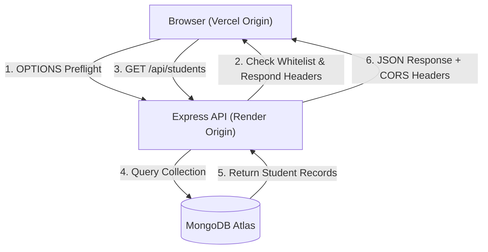

# Root Cause Analysis & Technical Solutions Guide

## Problem Statement
> **"A React frontend deployed on Vercel is unable to retrieve student records from an Express.js backend deployed on Render. Analyse the possible causes and implement appropriate solutions involving API configuration, environment variables, CORS and database connectivity."**

---

## 1. Deep Dive: Why Does This Happen?

In a decoupled cloud architecture:
- **Frontend** is served as static HTML, JavaScript, and CSS bundles from **Vercel's Edge Network / CDN** (e.g. `https://student-management.vercel.app`).
- **Backend** is an active Node.js / Express process hosted as a Web Service on **Render** (e.g. `https://student-records-backend.onrender.com`).
- **Database** is a hosted **MongoDB Atlas** cluster.

When a user opens the React application in their browser and clicks "View Students", the browser executes an asynchronous `fetch()` or `axios` call to the Render backend. Because the frontend origin (`https://student-management.vercel.app`) differs from the backend origin (`https://student-records-backend.onrender.com`), the browser enforces the **Same-Origin Policy (SOP)**.

If any of the four architectural pillars (**API Configuration**, **Environment Variables**, **CORS Configuration**, or **Database Connectivity**) is misconfigured, the request fails.



---

## 2. Comprehensive Analysis of the 10 Failure Scenarios & Verified Solutions

### Scenario 1: Incorrect API URL
- **Symptom**: Network tab shows `404 Not Found` or `ERR_NAME_NOT_RESOLVED`.
- **Root Cause**: The API URL has a typo, misses the `https://` protocol, or misses the `/api` prefix (calling `https://service.onrender.com/students` instead of `https://service.onrender.com/api/students`), or has a trailing slash mismatch (`/api/students/`).
- **Solution**:
  Centralize API URL resolution in `frontend/src/services/api.js`. Ensure the URL format is normalized:
  ```javascript
  const getBaseUrl = () => {
    const envUrl = import.meta.env.VITE_API_URL;
    if (envUrl && envUrl.trim()) {
      return envUrl.trim().replace(/\/$/, ''); // Strips any trailing slash
    }
    return 'http://localhost:5000/api';
  };
  ```

---

### Scenario 2: Missing Environment Variables
- **Symptom**: `import.meta.env.VITE_API_URL` evaluates to `undefined`, making the browser request `https://your-site.vercel.app/undefined/students` (which returns a 404 from Vercel's CDN).
- **Root Cause**:
  1. In Vite, environment variables **must be prefixed with `VITE_`** to be exposed to client-side code. Variables named `API_URL` or `REACT_APP_API_URL` are ignored by Vite.
  2. Vite evaluates environment variables **at build time** (`npm run build`). If the variable is set in Vercel after the build, it has no effect until a new deployment is triggered.
- **Solution**:
  1. Name the variable `VITE_API_URL` in `.env.example` and `.env`.
  2. In Vercel Project Settings -> **Environment Variables**, set:
     - Key: `VITE_API_URL`
     - Value: `https://<your-render-service>.onrender.com/api`
  3. Redeploy the frontend in Vercel so the build process bakes the new URL into the production bundle.

---

### Scenario 3: CORS Policy Errors
- **Symptom**:
  ```text
  Access to fetch at 'https://student-backend.onrender.com/api/students' from origin 
  'https://student-frontend.vercel.app' has been blocked by CORS policy: 
  No 'Access-Control-Allow-Origin' header is present on the requested resource.
  ```
- **Root Cause**:
  1. Browser sends a preflight `OPTIONS` request before `POST`, `PUT`, `DELETE`, or custom-header `GET` requests.
  2. If Express does not return `Access-Control-Allow-Origin: https://student-frontend.vercel.app` and `Access-Control-Allow-Methods: GET, POST, PUT, DELETE, OPTIONS`, the browser refuses to execute the main request.
  3. If `credentials: true` is enabled, using wildcard `origin: '*'` will be rejected by modern browsers.
- **Solution**:
  Configure dynamic origin resolution in `backend/middleware/corsConfig.js`:
  ```javascript
  const cors = require('cors');

  const corsOptions = {
    origin: (origin, callback) => {
      if (!origin) return callback(null, true); // Allow server-to-server / curl
      
      const allowed = [
        process.env.FRONTEND_URL,
        'http://localhost:5173',
        'http://localhost:3000',
      ];
      
      // Permit configured production domain or any Vercel preview deployment
      if (allowed.includes(origin) || /^https:\/\/[a-zA-Z0-9_-]+\.vercel\.app$/.test(origin)) {
        return callback(null, true);
      }
      return callback(new Error(`CORS blocked for origin: ${origin}`));
    },
    methods: ['GET', 'POST', 'PUT', 'DELETE', 'OPTIONS'],
    allowedHeaders: ['Content-Type', 'Authorization'],
    credentials: true,
  };

  app.use(cors(corsOptions));
  app.options('*', cors(corsOptions)); // Explicit preflight handling
  ```

---

### Scenario 4: MongoDB Connection Failures
- **Symptom**: Backend console outputs `MongooseServerSelectionError: connection timed out` or `ECONNREFUSED`. Requests to `/api/students` hang for 30 seconds and return a 500 error.
- **Root Cause**:
  MongoDB Atlas has a built-in firewall. By default, Atlas restricts all incoming connections. Render does not provide static outbound IP addresses on free tier accounts, meaning Render instances connect from dynamic cloud IP ranges.
- **Solution**:
  1. Open the [MongoDB Atlas Dashboard](https://cloud.mongodb.com/).
  2. Navigate to **Security** -> **Network Access**.
  3. Click **Add IP Address** and select **Allow Access From Anywhere** (`0.0.0.0/0`).
  4. Ensure Mongoose is configured with connection timeout protection:
     ```javascript
     mongoose.connect(process.env.MONGODB_URI, {
       serverSelectionTimeoutMS: 5000,
     });
     ```

---

### Scenario 5: Incorrect API Endpoint Paths
- **Symptom**: Client requests return HTML 404 pages from Express.
- **Root Cause**: Route mismatch. For instance, the frontend calls `/api/v1/students` or `/students`, but the backend defines routes under `/api/students`.
- **Solution**:
  Standardize route mounting in `backend/server.js`:
  ```javascript
  app.use('/api/students', studentRoutes);
  app.use('/api/health', healthRoutes);
  ```
  And implement a clean 404 JSON handler:
  ```javascript
  app.use((req, res) => {
    res.status(404).json({
      success: false,
      message: `API endpoint not found: ${req.method} ${req.originalUrl}`,
    });
  });
  ```

---

### Scenario 6: Backend Server Not Running (Render Cold Starts)
- **Symptom**: When loading the frontend for the first time, fetching student records takes 45 to 60 seconds, or fails with `502 Bad Gateway` / `504 Gateway Timeout`.
- **Root Cause**: Render's Free Web Service tier spins down the application container after **15 minutes of inactivity**. When a new incoming request hits the URL, Render spins up the container from cold storage, taking 40–50 seconds.
- **Solution**:
  1. Provide a responsive loading indicator with an explicit explanation that Render is waking up.
  2. Implement an automatic health probe (`/api/health`) on application mount to wake the Render instance before user actions occur.
  3. Provide an interactive "Ping Backend" button in the frontend navigation bar.

---

### Scenario 7: Frontend Calling Localhost in Production
- **Symptom**: Deployed Vercel site opens, but user's browser DevTools Network tab shows:
  `GET http://localhost:5000/api/students - net::ERR_CONNECTION_REFUSED`.
- **Root Cause**: Hardcoding `http://localhost:5000` inside React components or missing `VITE_API_URL` during the Vercel build step, falling back to localhost.
- **Solution**:
  Never hardcode URLs in React components. Centralize via environment variables:
  ```javascript
  // Central API client
  export const API_BASE_URL = import.meta.env.VITE_API_URL || 'http://localhost:5000/api';
  ```

---

### Scenario 8: Missing or Incorrect Database Credentials
- **Symptom**: Backend startup logs `MongoServerError: bad auth : authentication failed`.
- **Root Cause**:
  1. The password contains unescaped special characters (e.g. `@`, `#`, `%`, `&`, `/`). For instance, `@` in a password causes the MongoDB URI parser to treat the substring before `@` as user:password and the substring after `@` as the host.
  2. The Atlas database user has not been assigned the `readWriteAnyDatabase` or `readWrite` role on the specific database.
- **Solution**:
  1. Percent-encode special characters in the password:
     - `@` -> `%40`
     - `#` -> `%23`
     - `%` -> `%25`
  2. In MongoDB Atlas -> **Database Access** -> create a dedicated database user with password authentication and `Read and write to any database` privileges.

---

### Scenario 9: Render Deployment or Server Startup Errors
- **Symptom**: Render build succeeds, but deploy fails with `Port scan timeout` or `Exited with status 1`.
- **Root Cause**:
  1. Hardcoding port 5000: `app.listen(5000)`. Render dynamically allocates a port through the environment variable `process.env.PORT`.
  2. Binding only to localhost: `app.listen(PORT, '127.0.0.1')` instead of all interfaces (`0.0.0.0`).
  3. Missing `"start": "node server.js"` script in `package.json`.
- **Solution**:
  ```javascript
  // backend/server.js
  const PORT = process.env.PORT || 5000;
  app.listen(PORT, '0.0.0.0', () => {
    console.log(`Server running on port ${PORT}`);
  });
  ```
  Ensure `package.json` contains:
  ```json
  "scripts": {
    "start": "node server.js"
  }
  ```

---

### Scenario 10: Incorrect Frontend Build Configuration
- **Symptom**: The user can access the home page, but reloading on `/students` or direct URL navigation returns `404: NOT_FOUND` from Vercel.
- **Root Cause**: In Single Page Applications (SPAs), routing is performed client-side by JavaScript. When requesting `/students`, Vercel searches for a static file named `students.html`. Because the file does not exist, Vercel serves a 404 error.
- **Solution**:
  Add `frontend/vercel.json` with rewrite rules directing all requests to `/index.html`:
  ```json
  {
    "rewrites": [
      {
        "source": "/(.*)",
        "destination": "/index.html"
      }
    ]
  }
  ```
